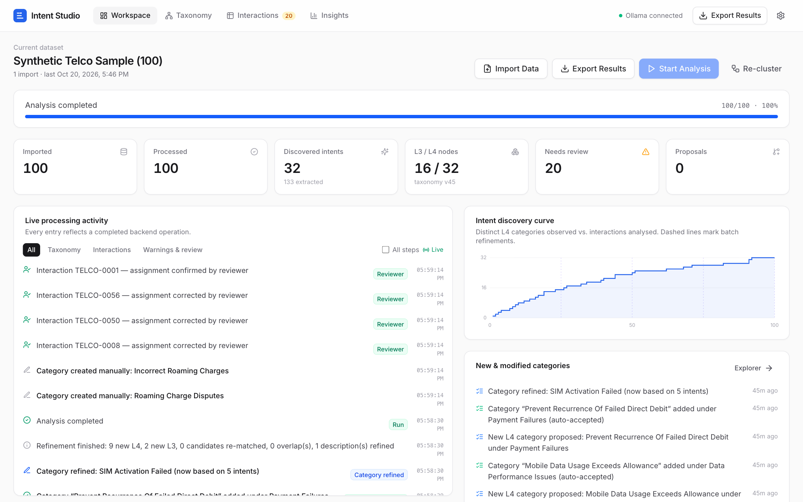
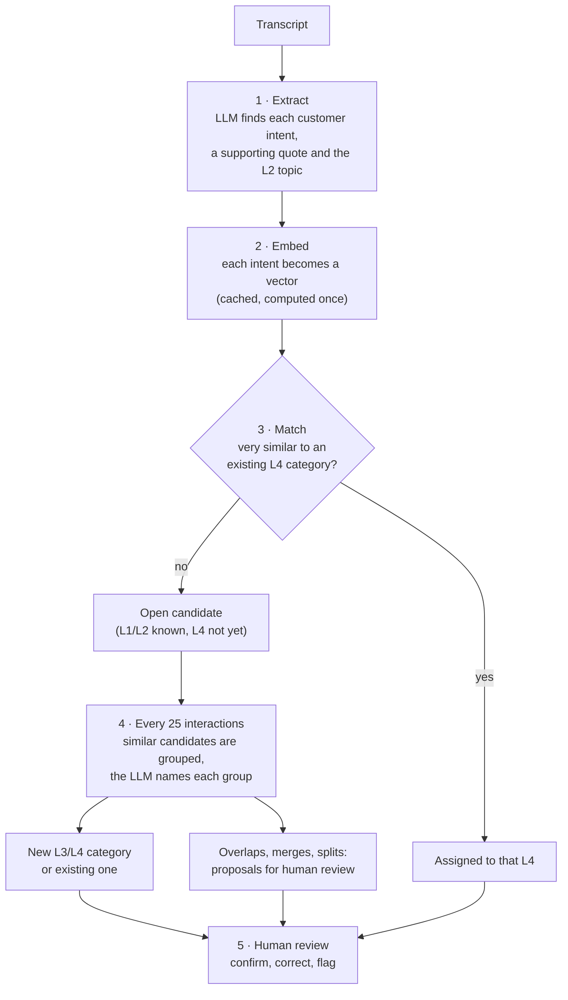
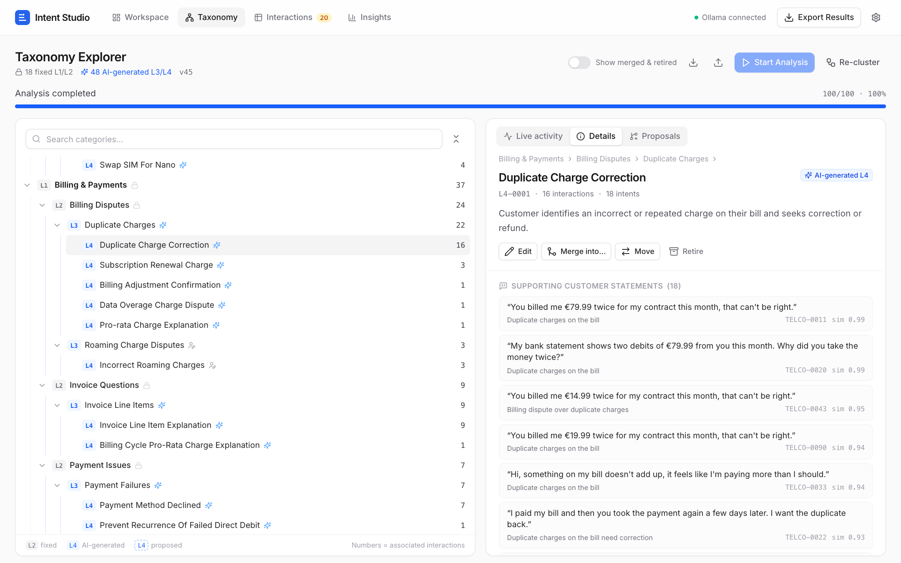
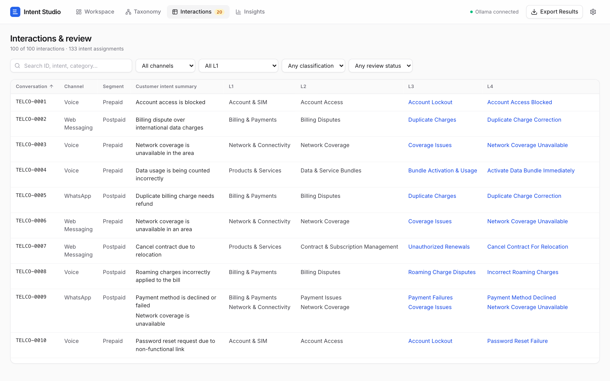
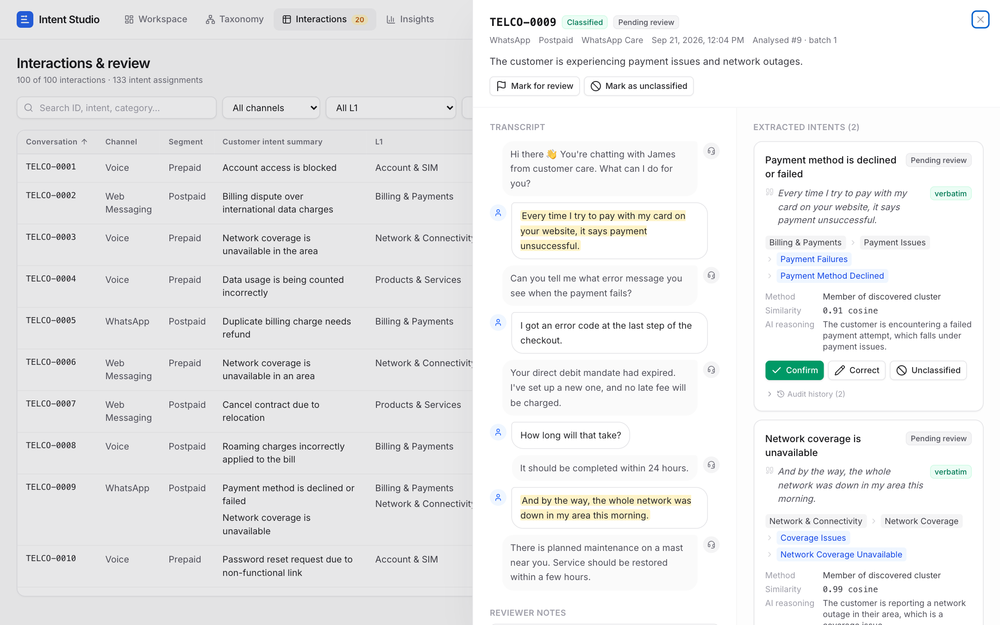
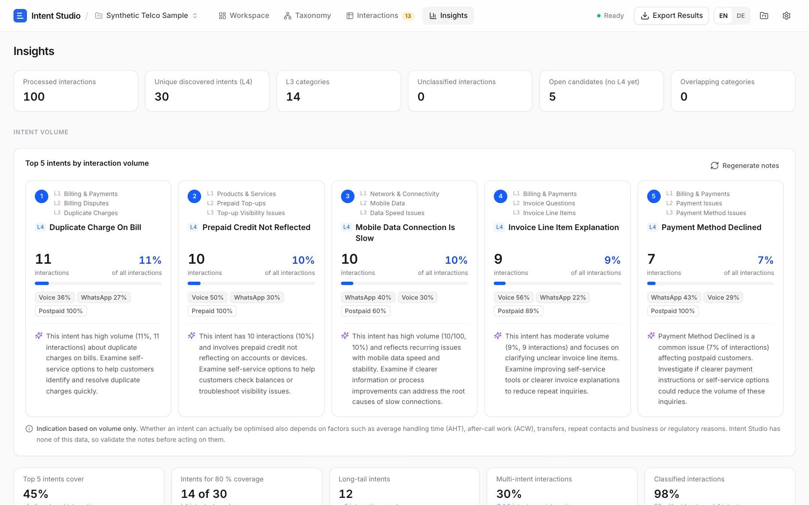

# Intent Studio - Local AI Taxonomy Discovery

Intent Studio turns customer-service transcripts into a traceable **L1 → L2 → L3 → L4 intent taxonomy**.
L1/L2 are predefined and fixed; L3/L4 are discovered from the data with a local LLM (via Ollama), semantic
embeddings and density-based clustering. Every step is persisted, streamed live to the UI, reviewable and exportable.



## How it works in one picture



| Step | What happens | Model |
| --- | --- | --- |
| 1. Extract | Each transcript is split into atomic customer intents, each with a verbatim quote and an L2 topic | `qwen3:8b` |
| 2. Embed | Intent texts are turned into 1024-dimensional vectors and cached in SQLite | `qwen3-embedding:0.6b` |
| 3. Match | An intent joins an existing L4 only when it is very similar; otherwise it waits as an open candidate | – |
| 4. Refine | Per batch, open candidates are clustered (HDBSCAN) and the LLM turns each cluster into a category | `qwen3:8b` |
| 5. Review | Merges, splits and uncertain decisions wait for a human; reviewed items are never overwritten by the AI | – |

## Screenshots

| Taxonomy Explorer | Interactions & review |
| --- | --- |
|  |  |
| **Conversation detail** | **Insights** |
|  |  |

## Installation

You need two machines (or one machine that does both):

- **The AI machine** (e.g. a gaming PC with a GPU) runs Ollama and the models.
- **Your computer** runs Intent Studio: the backend (Python) and the web interface (Node.js). All data stays here.

### 1. AI machine: Ollama and the models

1. Install Ollama from [ollama.com/download](https://ollama.com/download).
2. Download the two models (about 6 GB in total):

   ```bash
   ollama pull qwen3:8b
   ollama pull qwen3-embedding:0.6b
   ```

3. **Only if Ollama runs on a different machine than Intent Studio:** allow network access.
   By default, Ollama only accepts connections from its own machine.
   - Windows: set the environment variable `OLLAMA_HOST` to `0.0.0.0` (System settings → *Environment variables*),
     then quit Ollama from the system tray and start it again. Allow port `11434` in the Windows firewall if asked.
   - macOS / Linux: start Ollama with `OLLAMA_HOST=0.0.0.0 ollama serve`.
4. Note the machine's IP address (e.g. `192.168.1.20`). From your computer, this should list both models:

   ```bash
   curl http://192.168.1.20:11434/api/tags
   ```

A GPU with 8 GB VRAM or more is recommended. Without a GPU it works, but much more slowly.

### 2. Your computer: the tools

| Tool | Why | How to install | Check |
| --- | --- | --- | --- |
| Git | download the project | macOS: `xcode-select --install`; Windows: [git-scm.com](https://git-scm.com) | `git --version` |
| uv | installs Python 3.12 and the backend packages | `curl -LsSf https://astral.sh/uv/install.sh \| sh` (Windows: see [docs.astral.sh/uv](https://docs.astral.sh/uv/getting-started/installation/)) | `uv --version` |
| Node.js 20 or newer (LTS) | builds and serves the web interface | installer from [nodejs.org](https://nodejs.org) | `node --version` |

You do **not** need to install Python yourself: uv downloads Python 3.12 automatically (the Python 3.9 that ships with
macOS is too old). Docker, databases or cloud accounts are not needed.

### 3. Your computer: download and set up Intent Studio

```bash
git clone https://github.com/joe23byte/taxonomy-creator.git
cd taxonomy-creator

# configuration: point Intent Studio to the AI machine
cp .env.example .env
# open .env in a text editor and set OLLAMA_URL, e.g. OLLAMA_URL=http://192.168.1.20:11434
# (keep http://localhost:11434 if Ollama runs on this computer)

# backend: Python environment and packages (once)
cd backend
uv venv --python 3.12 .venv
uv pip install --python .venv/bin/python -r requirements.txt
cd ..

# web interface: packages (once)
cd frontend
npm install
cd ..
```

### 4. Start

Open **two terminal windows** in the project folder and leave both running:

```bash
# terminal 1 – backend (http://127.0.0.1:8000)
cd backend
.venv/bin/python -m app
```

```bash
# terminal 2 – web interface (http://127.0.0.1:5173)
cd frontend
npm run dev
```

Then open **http://127.0.0.1:5173** in your browser:

1. The header should show **Ollama connected**. If not, open Settings (gear icon), check the Ollama URL and click
   *Test connection* (it runs a real inference and embedding request).
2. Click **Load 100 Sample Interactions**, then **Start Analysis**. 100 interactions take about 7 minutes on a
   mid-range GPU (see [Performance reference](#performance-reference)).

To stop, press `Ctrl+C` in both terminals. Everything is saved; after the next start you continue where you left off.

**Windows:** use `.venv\Scripts\python` instead of `.venv/bin/python` (also in the `uv pip install` command), and
`copy .env.example .env` instead of `cp`.

### Optional

- **One process instead of two:** `cd frontend && npm run build` once; afterwards only start the backend and open
  http://127.0.0.1:8000.
- **Tests:** `cd backend && .venv/bin/python -m pytest` (uses a fake Ollama, no network needed).
- **Regenerate the synthetic dataset:** `cd backend && .venv/bin/python scripts/generate_sample_data.py`.

### Troubleshooting

| Problem | Fix |
| --- | --- |
| Header shows **Ollama offline** | Is the AI machine awake and Ollama running? Does `curl http://<ip>:11434/api/tags` work? Is `OLLAMA_HOST=0.0.0.0` set there? |
| Header shows **Model missing** | Run the two `ollama pull` commands on the AI machine (hover the indicator to see which model is missing). |
| Web page loads but shows no data | The backend (terminal 1) is not running. |
| `Address already in use` | Intent Studio is already running in another terminal. Stop it or use that one. |
| Analysis pauses by itself | Ollama became unreachable twice in a row. Fix the connection, then click **Resume**. |

## Demo walkthrough (acceptance test)

1. Header shows **Ollama connected**; Settings → Test connection shows inference + 1024-dim embeddings.
2. Workspace → **Load 100 Sample Interactions** → the Taxonomy tab shows the 4 L1 / 14 L2 fixed categories.
3. **Start Analysis**. The activity feed (SSE) shows each step per interaction; L2 nodes show growing
   "open" candidate counts; after each batch of 25, new L3/L4 nodes slide in (blue, sparkle icon), counts bump,
   touched nodes are highlighted, merges/splits are flagged in amber.
4. Click an L4 node → description, supporting customer quotes, creation/revision history.
5. Click a quote or open *Interactions* → full transcript with highlighted evidence, extracted intents, taxonomy
   path, cosine similarity, method, AI reasoning, alternative categories.
6. **Correct** an assignment (cascading L1–L4 selects) or Confirm / Unclassified / Flag; add notes.
7. Taxonomy → *Proposals* tab → approve or reject merges, splits and conflicting new categories.
8. **Export Results** → Excel (4 sheets), CSV or JSON.
9. Stop the backend and start it again: everything is in SQLite; an interrupted run shows **Resume**.

On a mid-range GPU, 100 interactions take about 7 minutes; see [Performance reference](#performance-reference).

## Project structure

```
backend/
  app/
    main.py              FastAPI routes, SSE endpoint, error handling, optional static frontend
    config.py            env defaults + sensitivity presets (UI settings stored in SQLite override them)
    db.py                SQLite connection, migrations runner, crash recovery, settings
    migrations/          versioned SQL schema (applied automatically at startup)
    ollama_client.py     /api/tags, /api/chat (JSON schema, think:false), /api/embed, retries, connection test
    importers.py         JSON / CSV / Excel / TXT → canonical records, column mapping, validation
    extraction.py        intent extraction prompt + schema, evidence verification
    embeddings.py        embedding cache (SQLite BLOBs keyed by model + text hash), centroids
    clustering.py        cosine similarity, HDBSCAN, agglomerative fallback, split detection
    taxonomy.py          nodes, proposals, accept/reject, merge/split/refine, versions, manual edits
    taxonomy_builder.py  LLM prompts for cluster naming, outlier placement, refinement, split labels
    assignments.py       many-to-many assignments, review actions, audit history
    pipeline.py          per-interaction processing and batch refinement
    worker.py            single background worker: start / pause / stop / resume / re-cluster
    events.py            persisted event log + SSE tailing (replayable)
    interactions.py      read models for the review UI
    insights.py          progress metrics and discovery curve
    evaluation.py        optional ground-truth comparison (Insights only, never used by the pipeline)
    export.py            Excel / CSV / JSON exports
  data/
    taxonomy_seed.json   editable predefined L1/L2 taxonomy
    sample/              sample_transcripts.json/.csv, sample_ground_truth.json, import_template.csv
  scripts/generate_sample_data.py   reproducible synthetic dataset (fixed seed)
  tests/                 pytest suite with a fake Ollama transport
frontend/
  src/views/             Workspace, TaxonomyView, InteractionsView, InsightsView
  src/components/        taxonomy tree & detail, activity feed, interaction detail, dialogs, ui primitives
  src/lib/               API client, live SSE provider
```

## How the taxonomy is built

**Extraction.** Each transcript is sent with the active L2 list to `qwen3:8b` (`think: false`, temperature 0,
`format` = JSON schema whose `category_id` is an enum of valid L2 ids + `UNMATCHED`). The output is validated with
Pydantic; malformed answers are retried with feedback, then the interaction is marked *failed* without touching the
taxonomy. Each intent has a normalized description, an L2, a verbatim customer quote (checked against the transcript:
*verbatim / approx. / not found*) and a one-sentence reasoning. `UNMATCHED` intents get no L1/L2 and are queued for review
— the system never invents L1/L2 categories.

**Matching.** Intent texts are embedded once (cache in SQLite). A candidate joins an existing L4 only if its cosine
similarity to that category's centroid exceeds the *match* threshold; the closest categories are stored as alternatives.
Everything else stays an open candidate (L1/L2 only).

**Batch refinement** (every `batch_size` interactions, default 25): per L2, open candidates are clustered with
HDBSCAN on cosine distance (agglomerative average-linkage fallback for < 5 points or all-noise results; every cluster
must meet the cohesion threshold, loose clusters are re-split). For each cluster the LLM sees the existing L3/L4 nodes
of that L2 and either maps the cluster to an existing L4 or proposes a new L4 under an existing or new L3 (ids are
enum-constrained). If the LLM maps a cluster to an existing L4 whose centroid is semantically distant (below the *match*
threshold), it is asked again without that category, and the alternative goes to human review. This keeps a generic
category from absorbing a related but different intent (e.g. roaming charges vs. duplicate charges). Proposals with a conflict (very similar centroid to an existing category, duplicate label elsewhere)
are never auto-accepted. Afterwards: re-matching of open candidates, overlap detection (L4 and L3 centroid similarity →
merge proposals), description refinement when a category's support doubles, split detection (separated sub-clusters).
At the end of a run, rare intents that never clustered are placed by the LLM (existing L4, new low-support L4 flagged for
review, or left unclassified for a human).

**Calibration.** On `qwen3-embedding:0.6b`, pairs of real extracted statements of the same intent have a median cosine of
≈0.85, while distinct intents in the same L2 have a median of ≈0.66 but their top 5 % reach ≈0.78. Embeddings alone
cannot separate near-synonyms, so they only auto-match at high similarity and the
LLM makes the semantic decisions at batch boundaries. Sensitivity presets (Settings) shift all thresholds.

**Governance.**
- New, non-conflicting L3/L4 nodes are auto-accepted when *Auto-accept* is on (default); otherwise they appear as dashed
  *proposed* nodes until approved. Merges and splits always require approval. Nothing is deleted: merged/split/retired
  nodes keep their id and history (toggle *Show merged & retired*).
- Every applied change bumps the taxonomy version and is recorded in `taxonomy_changes` (Sheet 4 of the export).
- Human-reviewed assignments (confirmed / corrected / unclassified) are never changed by AI or restructuring; when their
  category is merged/split/retired they are flagged for re-review instead. Unreviewed assignments are recalculated.
- Every assignment keeps its latest AI assignment (`ai_original`) and a full audit trail.
- No confidence percentages are shown. The UI shows cosine similarity (labelled as such), the method, and *Needs review*.

**Durability.** Each interaction's intents, assignments and status are committed in one transaction; each cluster decision
is committed separately. On restart, runs that were *running* become *interrupted* and half-processed interactions are
rolled back to *pending*, so **Resume** never processes an interaction twice. Embeddings are never recomputed for known texts.
Importing more data later and pressing Start processes only the new interactions and refines the existing structure.

## Performance reference

Measured on October 20, 2026 with the 100 synthetic sample interactions, starting from an empty database
(only the predefined 4 L1 / 14 L2 categories, no cached embeddings), batch size 25, sensitivity *medium*.

### Reference hardware

The AI machine is a desktop PC with an **AMD Radeon RX 7700 XT (12 GB VRAM)** running Ollama. Intent Studio itself ran
on a Mac in the same local network; its own computing load is negligible.

| | Qwen3 8B (LLM) | Qwen3 Embedding 0.6B |
| --- | --- | --- |
| Memory according to Ollama | 6.3 GB | 5.8 GB |
| Processor | 100 % GPU | 100 % GPU |
| Context window | 8,192 tokens | 32,768 tokens |
| Runtime | llama.cpp | llama.cpp |

Both models fit completely into VRAM at the same time, so no model computation is offloaded to the CPU and Ollama
never has to swap models between requests. This is the most important precondition for the numbers below.

### Where the time goes

Total run time: **6.5 minutes for 100 interactions (3.9 s per interaction)**.

| Part | Time | Share |
| --- | --- | --- |
| Processing the 100 conversations (extraction, embedding, matching) | 4.1 min (2.4 s per conversation) | ≈ 62 % |
| Batch refinements after 25, 50, 75 and 100 conversations | 19–27 s each, ≈ 1.5 min in total | ≈ 24 % |
| Final pass (placing rare intents that never formed a cluster) | ≈ 54 s | ≈ 14 % |

- Per conversation: median 2.0 s; 80 % of the conversations take between 1.6 and 3.2 s. The very first conversation
  took 14 s because Ollama had to load the model into VRAM.
- Almost all of that is the LLM extraction. One embedding request takes about 0.03 s.
- Conversations with several intents take somewhat longer (≈ 0.75 s per additional intent); transcript length hardly
  matters.

### Does it get slower as the taxonomy grows?

No. The processing time per conversation stays flat whether no L4 category exists yet or 18 already do, because the
extraction prompt only contains the fixed L2 categories:

| Conversations | Ø time per conversation | L4 categories before | Intents matched immediately |
| --- | --- | --- | --- |
| 1–20 | 2.9 s (incl. model loading) | 0 | 0 % |
| 21–40 | 2.4 s | 4.5 | 25 % |
| 41–60 | 2.3 s | 9.5 | 46 % |
| 61–80 | 2.4 s | 14 | 50 % |
| 81–100 | 2.2 s | 18 | 52 % |

Indirectly it tends to get **faster**: at the start every intent is an open candidate, from the middle on about half
are matched to an existing category by embedding alone, which costs practically nothing. Fewer open candidates mean
less work in the batch refinements: the first two batches took 27 s and 25 s, the last two 19 s and 21 s. With only
100 interactions this is a trend, not yet a reliable measurement.

### Projection for larger datasets

Estimates for the reference hardware, extrapolated from the measurement above. They assume conversations similar to the
sample (≈ 1.3 intents each) and one analysis job at a time.

| Interactions | Lower bound: extraction only (2.4 s) | Expected: saturation, batch size 100 (≈ 2.8 s) | Conservative: refinement as measured (≈ 3.3 s) |
| --- | --- | --- | --- |
| 1,000 | ≈ 40 min | ≈ 47 min | ≈ 55 min |
| 2,500 | ≈ 1.7 h | ≈ 1.9 h | ≈ 2.3 h |
| 5,000 | ≈ 3.3 h | ≈ 3.9 h | ≈ 4.6 h |

Add roughly 5–20 minutes for the final pass; it grows with the number of rare intents in the long tail. The
*expected* column assumes that refinement drops to ≈ 0.4 s per interaction once most intents match existing categories;
the *conservative* column keeps the measured ≈ 0.9 s per interaction.

These numbers only hold while the AI machine runs at full speed. In an earlier run on the same machine, started right
after it had woken from sleep mode, the identical analysis (same decisions, same results) took 3.5 times as long. Plan
large runs with that margin, or re-measure with the sample dataset first.

### Recommendations for productive use

- **Up to ≈ 1,000 interactions:** about an hour on the reference hardware.
- **2,500–5,000 interactions:** a few hours; start it in the evening and let it run overnight. Runs survive restarts
  and can be paused and resumed, so the work can also be split into several sessions.
- **Build the taxonomy on a sample first:** analyse a representative 500–1,000 interactions, review the proposals and
  correct the taxonomy, then import and process the rest. Later interactions then mostly match existing categories,
  which reduces refinement work and the review effort. The extraction cost per conversation stays the same.
- **Increase the batch size to 50–100** for large datasets (Settings). Fewer, larger refinements need fewer LLM calls
  per interaction and give HDBSCAN more data per cluster.
- **Keep the AI machine awake:** disable sleep mode for the duration of the run. If Ollama stops responding, Intent
  Studio pauses the run after two failed requests; press **Resume** once the machine is back.

### Hardware matters

The GPU and its VRAM determine the performance more than anything else:

- **Everything must fit into VRAM.** If Ollama shows less than 100 % GPU for a model, part of the computation runs on
  the CPU and processing becomes several times slower. Both models together currently need ≈ 12 GB, which is the whole
  VRAM of the RX 7700 XT.
- **Generation speed scales with GPU memory bandwidth.** The extraction time is dominated by generating the JSON answer
  token by token. GPUs with higher memory bandwidth (and enough VRAM) process each conversation correspondingly faster;
  slower or older GPUs, or CPU-only machines, correspondingly slower. Re-measure on your own hardware with the sample
  dataset before planning a large run.
- **The GPU's state matters, too.** Power-saving states after waking from sleep, other programs using the GPU (games,
  video) or thermal throttling slow down generation even when Ollama reports 100 % GPU. Before a long run, check with
  `ollama ps` that both models are loaded and the machine is otherwise idle.
- **VRAM tuning potential:** the embedding model is loaded with its default 32,768-token context, although intent
  texts are only a few dozen tokens long. That context accounts for most of its 5.8 GB. Requesting a smaller context
  (for example 2,048 tokens) would free several GB of VRAM. Intent Studio does not do this yet.
- **No parallel processing yet:** Intent Studio sends one request at a time. A GPU with spare capacity could serve
  several conversations in parallel (Ollama `OLLAMA_NUM_PARALLEL`), which would need a concurrent worker; this is a
  possible future extension.

## Import format

Canonical JSON (one object per conversation):

```json
[{"conversation_id": "TELCO-0001", "channel": "voice", "segment": "prepaid", "language": "en",
  "timestamp": "2026-10-20T10:00:00Z", "queue": "Prepaid Support",
  "turns": [{"speaker": "customer", "text": "I topped up yesterday, but the credit is still missing."},
            {"speaker": "agent", "text": "I can check the transaction for you."}]}]
```

- **CSV / Excel**: either one row per conversation with a `transcript` column (`Customer: … / Agent: …` lines) or one
  row per message (conversation id + speaker + text columns). Columns are auto-detected and can be re-mapped in the
  import dialog. Template: `backend/data/sample/import_template.csv`.
- **TXT**: each file is one interaction (optional separator to split one file into several).
- Missing metadata is allowed; missing IDs are generated; already-imported conversation IDs are skipped.
- The canonical structure mirrors what can be derived from Genesys Cloud conversation exports, so an API connector can
  be added later by producing the same records (no Genesys OAuth in this MVP).

## Synthetic dataset

`scripts/generate_sample_data.py` (seed `20261020`) produces 100 English conversations (4–12 turns) across prepaid voice,
postpaid voice, WhatsApp, web messaging and social media with 22 underlying intent types in a long-tail distribution
(11 occurrences down to 1), 14 multi-intent conversations, 6 deliberately ambiguous ones, 12 with small talk and several
near-synonym pairs (lost SIM / SIM swap / SIM activation, tariff upgrade / downgrade, roaming / overage / duplicate charges,
password reset / account locked). Labels live only in `sample_ground_truth.json`, which is read exclusively by the
Insights comparison (a test asserts that pipeline modules never reference it).

## Privacy & security

- Local-first: data is stored in `backend/var/intent_studio.db` on this computer. No cloud AI APIs, no telemetry, no
  third-party storage; fonts are bundled locally.
- **The configured Ollama server receives transcript text for inference.** If it runs on another machine (e.g. the
  gaming PC), transcripts travel over your network. Use synthetic data for demos; for real customer data use only an
  approved, secured network connection (e.g. VPN / encrypted tunnel) and an approved machine.
- Logs contain no transcript content; unhandled errors return only the exception type; Ollama errors never echo prompts.
- The web server binds to `127.0.0.1` by default (`INTENT_STUDIO_HOST`). `.env` and the database are git-ignored.

## What is (not) in Git

Committed: source code, the predefined taxonomy, the synthetic sample dataset and the tests.
Never committed (see `.gitignore`): `.env` (Ollama URL and model settings), the SQLite database in `backend/var/`
(transcripts, embeddings, reviews), exported result files, `node_modules/`, `.venv/` and build output.

On another computer, follow [Installation](#installation). The workspace (imports, taxonomy, reviews) lives only in the local database. To move it to another computer, copy
`backend/var/intent_studio.db` while the backend is stopped, or use the JSON export.

## Limitations

- 100 interactions are not enough to claim a complete taxonomy; the discovery curve shows saturation for this dataset only.
- Automatic L2 choice by the LLM can differ for borderline intents (e.g. data usage vs. mobile data); reviewers can correct it.
- One analysis job runs at a time; the app is single-user by design.
