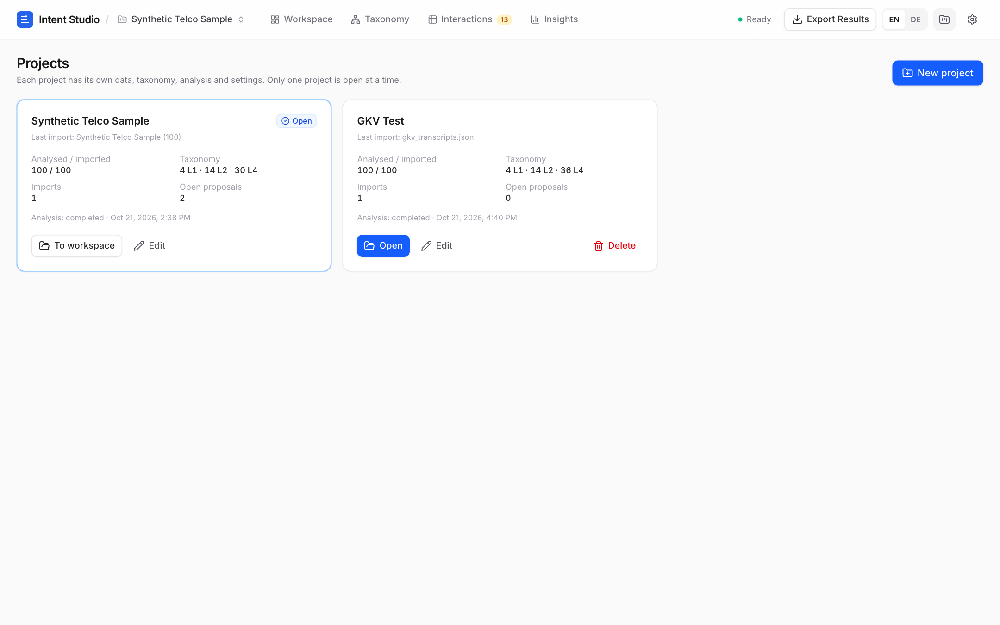
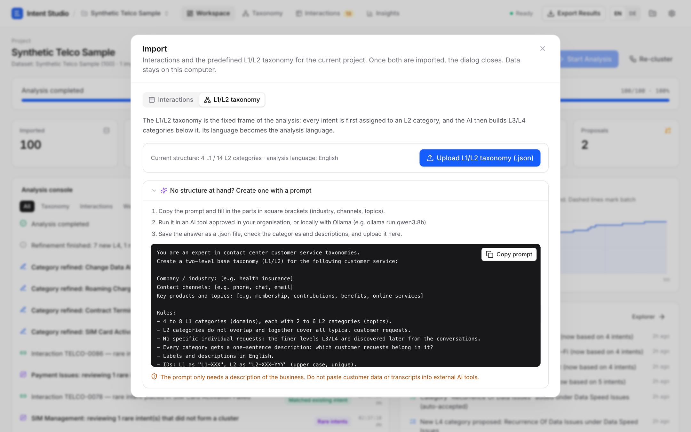
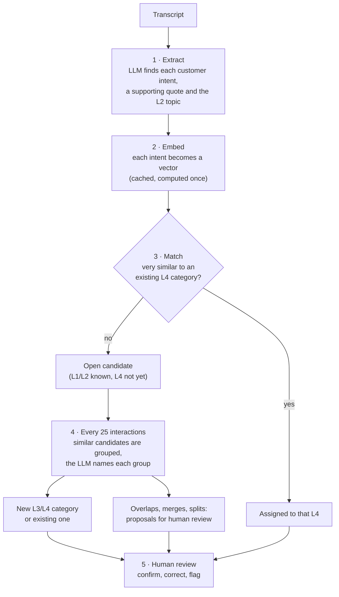

# Intent Studio - Local AI Taxonomy Discovery

Intent Studio turns customer-service transcripts into a traceable **L1 → L2 → L3 → L4 intent taxonomy**.
You provide L1/L2; L3/L4 are discovered from the data with a local LLM (via Ollama), semantic embeddings and
density-based clustering. Every step is persisted, shown live in the analysis console, reviewable and exportable,
including a branded PDF report. Analyses live in separate **projects**, and the interface is available in
**English and German**.


## Contents

- [Features](#features)
- [Screenshots](#screenshots)
- [Quick start with Cursor](#quick-start-with-cursor)
- [Installation](#installation)
  - [1. AI machine: Ollama and the models](#1-ai-machine-ollama-and-the-models)
  - [2. Your computer: the tools](#2-your-computer-the-tools)
  - [3. Download and set up Intent Studio](#3-download-and-set-up-intent-studio)
  - [4. Start](#4-start)
  - [Troubleshooting](#troubleshooting)
- [Using Intent Studio](#using-intent-studio)
- [Import format](#import-format)
- [Projects, language and branding](#projects-language-and-branding)
- [Export and PDF report](#export-and-pdf-report)
- [Example datasets](#example-datasets)
- [Performance](#performance)
- [How it works](#how-it-works)
- [Project structure](#project-structure)
- [Privacy & security](#privacy--security)
- [What is (not) in Git](#what-is-not-in-git)
- [Limitations](#limitations)

## Features

- **Local AI only:** `qwen3:8b` and `qwen3-embedding:0.6b` via Ollama, on a GPU machine in your network or on an
  Apple Silicon Mac. No cloud AI, no telemetry.
- **Your L1/L2, discovered L3/L4:** import your own L1/L2 structure (or create one with the built-in prompt guide);
  L3/L4 categories are named and described by the LLM in the language of your taxonomy.
- **Traceable:** every assignment shows the customer quote, cosine similarity, method, AI reasoning and alternatives.
- **Human in the loop:** confirm, correct or flag assignments; merges, splits and conflicts wait for approval.
  Human decisions are never overwritten by the AI.
- **Insights:** top 5 intents by volume with an AI note, concentration KPIs, intent mix, coverage and discovery
  curves, overlap check. Every metric links to the matching filtered view.
- **Export:** PDF report with your logo, Excel, CSV and JSON.
- **Robust:** SQLite per project; runs survive restarts and can be paused and resumed.

## Screenshots

| Taxonomy Explorer | Interactions & review |
| --- | --- |
|  |  |
| **Conversation detail** | **Insights** |
|  |  |
| **Projects** | **Import: L1/L2 taxonomy with prompt guide** |
|  |  |

## Quick start with Cursor

If you use [Cursor](https://cursor.com), you don't have to follow the installation steps by hand. Open an empty
folder in Cursor, start an agent chat and paste this prompt:

```text
Set up Intent Studio from https://github.com/joe23byte/taxonomy-creator on this computer.

1. Clone the repository into this folder and read the README.
2. Ask me whether Ollama runs on this computer or on another machine in my network (then ask for its IP).
3. Check Git, uv and Node.js 20+ and install what is missing. If Ollama should run here,
   install it and pull qwen3:8b and qwen3-embedding:0.6b.
4. Create .env from .env.example with the right OLLAMA_URL and install the backend and frontend
   dependencies exactly as described in the README.
5. Start the backend and the web interface, check that /api/ollama/status reports both models,
   and give me the URL to open.
Explain each step briefly and ask before installing anything system-wide.
```

The agent runs the same steps as described below and asks for approval before executing commands. Afterwards, continue
with [Using Intent Studio](#using-intent-studio).

## Installation

You need two machines (or one machine that does both):

- **The AI machine** (e.g. a gaming PC with a GPU) runs Ollama and the models.
- **Your computer** runs Intent Studio: the backend (Python) and the web interface (Node.js). All data stays here.

An Apple Silicon Mac with at least 16 GB of memory can do both. It is several times slower than a gaming GPU, but
transcripts never leave the machine (see [Performance](#performance)).

### 1. AI machine: Ollama and the models

1. Install Ollama from [ollama.com/download](https://ollama.com/download).
2. Download the two models (about 6 GB in total):

   ```bash
   ollama pull qwen3:8b
   ollama pull qwen3-embedding:0.6b
   ```

3. **Only if Ollama runs on a different machine than Intent Studio:** allow network access.
   By default, Ollama only accepts connections from its own machine.
   - Windows: set the environment variable `OLLAMA_HOST` to `0.0.0.0` (System settings → *Environment variables*),
     then quit Ollama from the system tray and start it again. Allow port `11434` in the Windows firewall if asked.
   - macOS / Linux: start Ollama with `OLLAMA_HOST=0.0.0.0 ollama serve`.
4. Note the machine's IP address (e.g. `192.168.1.20`). From your computer, this should list both models:

   ```bash
   curl http://192.168.1.20:11434/api/tags
   ```

A GPU with 8 GB VRAM or more is recommended. Without a GPU it works, but much more slowly.

### 2. Your computer: the tools

| Tool | Why | How to install | Check |
| --- | --- | --- | --- |
| Git | download the project | macOS: `xcode-select --install`; Windows: [git-scm.com](https://git-scm.com) | `git --version` |
| uv | installs Python 3.12 and the backend packages | `curl -LsSf https://astral.sh/uv/install.sh \| sh` (Windows: see [docs.astral.sh/uv](https://docs.astral.sh/uv/getting-started/installation/)) | `uv --version` |
| Node.js 20 or newer (LTS) | builds and serves the web interface | installer from [nodejs.org](https://nodejs.org) | `node --version` |

You do **not** need to install Python yourself: uv downloads Python 3.12 automatically (the Python 3.9 that ships with
macOS is too old). Docker, databases or cloud accounts are not needed.

### 3. Download and set up Intent Studio

```bash
git clone https://github.com/joe23byte/taxonomy-creator.git
cd taxonomy-creator

# configuration: point Intent Studio to the AI machine
cp .env.example .env
# open .env in a text editor and set OLLAMA_URL, e.g. OLLAMA_URL=http://192.168.1.20:11434
# (keep http://localhost:11434 if Ollama runs on this computer)

# backend: Python environment and packages (once)
cd backend
uv venv --python 3.12 .venv
uv pip install --python .venv/bin/python -r requirements.txt
cd ..

# web interface: packages (once)
cd frontend
npm install
cd ..
```

After updating the code (`git pull`), run the two install commands again; new versions may add packages.

### 4. Start

Open **two terminal windows** in the project folder and leave both running:

```bash
# terminal 1 – backend (http://127.0.0.1:8000)
cd backend
.venv/bin/python -m app
```

```bash
# terminal 2 – web interface (http://127.0.0.1:5173)
cd frontend
npm run dev
```

Then open **http://127.0.0.1:5173**. The header should show **Ready**; if not, open Settings (gear icon), check the
Ollama URL and click *Test connection*. To stop, press `Ctrl+C` in both terminals. Everything is saved; after the next
start you continue where you left off.

**Windows:** use `.venv\Scripts\python` instead of `.venv/bin/python` (also in the `uv pip install` command), and
`copy .env.example .env` instead of `cp`.

**Optional:**

- **One process instead of two:** `cd frontend && npm run build` once; afterwards only start the backend and open
  http://127.0.0.1:8000.
- **Tests:** `cd backend && .venv/bin/python -m pytest` (uses a fake Ollama, no network needed).

### Troubleshooting

| Problem | Fix |
| --- | --- |
| Header shows **Ollama offline** | Is the AI machine awake and Ollama running? Does `curl http://<ip>:11434/api/tags` work? Is `OLLAMA_HOST=0.0.0.0` set there? |
| Header shows **Model missing** | Run the two `ollama pull` commands on the AI machine (hover the indicator to see which model is missing). |
| Web page loads but shows no data | The backend (terminal 1) is not running. |
| `Address already in use` | Intent Studio is already running in another terminal. Stop it or use that one. |
| `ModuleNotFoundError` after an update | Run `uv pip install --python .venv/bin/python -r requirements.txt` in `backend/` again. |
| Analysis pauses by itself | Ollama became unreachable twice in a row. Fix the connection, then click **Resume**. |

## Using Intent Studio

1. **Create a project:** project menu next to the logo → **New project**. New projects start empty.
   (A fresh installation also contains a first project with the English telco example taxonomy.)
2. **Import** → *L1/L2 taxonomy*: upload your structure, e.g. `backend/data/examples/gkv/gkv_taxonomy_l1_l2.json`.
   No structure yet? The tab contains a copyable prompt that lets any LLM create one (see [L1/L2 taxonomy](#l1l2-taxonomy)).
   The analysis language is detected from the taxonomy.
3. **Import** → *Interactions*: upload transcripts, e.g. `backend/data/examples/gkv/gkv_transcripts.json`. The dialog
   closes by itself once taxonomy and interactions are both in place.
4. **Start Analysis.** The analysis console shows every step; after each batch (default 25 interactions) new L3/L4
   categories appear in the tree. Pause, stop and resume at any time.
5. **Review:** click an L4 category for its description, customer quotes and history; open *Interactions* to see a
   transcript with highlighted evidence. Confirm, correct (cascading L1–L4 selects), mark as unclassified or flag.
   Taxonomy → *Proposals* lists merges, splits and conflicting categories for approval.
6. **Insights:** top 5 intents by volume with path, share, channel and segment mix and a short AI note on why the
   intent deserves a closer look (a volume-based indication only; handling time, transfers or business reasons are
   not known to the tool). Every metric card opens the matching view, e.g. *Open candidates* → Interactions filtered
   to *L1/L2 only*.
7. **Export Results:** PDF report, Excel, CSV or JSON (see [Export and PDF report](#export-and-pdf-report)).

Importing more data later and pressing Start processes only the new interactions and refines the existing structure.
To rebuild L3/L4 from scratch (e.g. after changing settings), use Settings → *Reset analysis*.

## Import format

### Interactions

Canonical JSON (one object per conversation):

```json
[{"conversation_id": "TELCO-0001", "channel": "voice", "segment": "prepaid", "language": "en",
  "timestamp": "2026-10-20T10:00:00Z", "queue": "Prepaid Support",
  "turns": [{"speaker": "customer", "text": "I topped up yesterday, but the credit is still missing."},
            {"speaker": "agent", "text": "I can check the transaction for you."}]}]
```

- **CSV / Excel:** either one row per conversation with a `transcript` column (`Customer: … / Agent: …` lines) or one
  row per message (conversation id + speaker + text columns). Columns are auto-detected and can be re-mapped in the
  import dialog.
- **TXT:** each file is one interaction (optional separator to split one file into several).
- Speaker labels such as `customer`, `client`, `caller`, `Kunde` and `agent`, `advisor`, `Mitarbeiter` are recognised;
  lines without a speaker count as customer text.
- Missing metadata is allowed; missing IDs are generated; already-imported conversation IDs are skipped.
- The import dialog explains these formats and offers JSON and CSV templates for download.
- The structure mirrors what can be derived from Genesys Cloud conversation exports, so an API connector can be added
  later by producing the same records.

### L1/L2 taxonomy

The analysis can only start once an L1/L2 taxonomy is imported (**Import → L1/L2 taxonomy**):

```json
{"name": "My taxonomy",
 "language": "en",
 "categories": [
   {"id": "L1-BIL", "level": 1, "parent_id": null, "label": "Billing & Payments",
    "description": "Invoices, charges and payments."},
   {"id": "L2-BIL-DSP", "level": 2, "parent_id": "L1-BIL", "label": "Billing Disputes",
    "description": "Customer believes a charge is wrong."}]}
```

- Only levels 1 and 2; `id`, `label` and `level` are required, IDs must be unique, every L2 needs an existing L1 as
  `parent_id`. L3/L4 are never imported; they are discovered from the data.
- Descriptions matter: the LLM uses label and description to choose the L2 for each intent.
- The import replaces the current L1/L2 structure and is only possible while no interaction is assigned yet
  (otherwise reset the analysis first).
- **No structure yet?** The taxonomy tab contains a copyable prompt (industry, channels and topics in square brackets)
  that makes any LLM return a valid file, e.g. an approved AI tool or `ollama run qwen3:8b` locally. It needs only a
  description of the business; never paste customer data into external AI tools.
- **Analysis language:** detected from labels and descriptions (German, English, French, Spanish, Italian or Dutch),
  or taken from the optional `"language"` field. All generated content follows it: intents, summaries, L3/L4 names and
  descriptions, split proposals. It can be changed in Settings → *Analysis language*; this affects only categories
  created afterwards.

## Projects, language and branding

- **Projects:** each project is a separate workspace (interactions, taxonomy, results, reviews, settings) stored in its
  own SQLite file. The project menu switches and creates projects; the folder icon opens the overview with counts per
  project, where projects can be renamed and deleted. Switching is blocked while an analysis is running.
- **Interface language:** the **EN / DE** switch in the header changes all interface texts (stored per browser). The
  texts live in `frontend/src/i18n/en.json` and `de.json` with identical keys. Category names are generated in the
  project's analysis language, independent of the interface language.
- **Branding:** Settings → **Branding** takes a logo (PNG, JPG, WebP or GIF; transparent margins are trimmed). It
  replaces the icon in the app header and appears on every page of the PDF report. It applies to all projects.

## Export and PDF report

| Format | Content |
| --- | --- |
| **PDF report** | Project and dataset details, KPIs, top 5 intents with notes, intent mix, coverage and discovery curves, overlap check and the complete taxonomy (L1–L4 with descriptions and counts), with your logo in the header |
| **Excel** | 4 sheets: taxonomy, interaction assignments (intents with L1–L4 paths), review queue, taxonomy changes |
| **CSV** | one sheet, or all four as a ZIP |
| **JSON** | full machine-readable export (always English keys) |

PDF, Excel and CSV use the interface language for headers, sheet names, status values and report texts.

## Example datasets

| Dataset | Location | Content |
| --- | --- | --- |
| Telco (English) | `backend/data/sample/` | 100 conversations (prepaid/postpaid voice, WhatsApp, web messaging, social), 22 intent types in a long tail, multi-intent, ambiguous and small-talk cases, near-synonym pairs; L1/L2 in `backend/data/taxonomy_seed.json` |
| Statutory health insurance (German) | `backend/data/examples/gkv/` | 100 conversations (voice, web messaging, email), 22 intent types such as delayed sick pay, replacement health card or family insurance; `gkv_taxonomy_l1_l2.json` with 4 L1 / 14 L2 |

Both are synthetic and reproducible (`backend/scripts/generate_sample_data.py`, `generate_gkv_sample.py`). The
`*_ground_truth.json` files are read only by the optional comparison in Insights, never by the analysis.

## Performance

Measured with 100 synthetic interactions, empty taxonomy, batch size 25, sensitivity *medium*:

| Setup | 100 interactions | Per interaction | 1,000 interactions (estimate) |
| --- | --- | --- | --- |
| Desktop PC, **AMD Radeon RX 7700 XT (12 GB VRAM)** | 6.5 min | 3.9 s | ≈ 45–55 min |
| **MacBook Air M5, 24 GB** (everything on one machine) | 40 min | 24 s | ≈ 5–6 h |

- **Results are equivalent** on both machines; the Mac is slower because of lower memory bandwidth and because it
  throttles under sustained load (no fan).
- **Where the time goes:** ≈ 60 % LLM extraction per conversation, ≈ 25 % batch refinements, ≈ 15 % a final pass for
  rare intents. Embeddings are negligible.
- **It does not get slower as the taxonomy grows;** later interactions often match existing categories directly.
- **Both models must fit completely into GPU memory** (≈ 7 GB together). Check with `ollama ps` that both show
  100 % GPU; otherwise processing becomes several times slower.
- **For large datasets:** build the taxonomy on a representative sample of 500–1,000 interactions first, review it,
  then import the rest. Set the batch size to 50–100, keep the AI machine awake (on a Mac: power adapter and
  `caffeinate -i`) and run 2,500+ interactions overnight. Runs can be paused and resumed.

## How it works

<details>
<summary>Pipeline overview, models and how the taxonomy is built</summary>



| Step | What happens | Model |
| --- | --- | --- |
| 1. Extract | Each transcript is split into atomic customer intents, each with a verbatim quote and an L2 topic | `qwen3:8b` |
| 2. Embed | Intent texts are turned into 1024-dimensional vectors and cached in SQLite | `qwen3-embedding:0.6b` |
| 3. Match | An intent joins an existing L4 only when it is very similar; otherwise it waits as an open candidate | – |
| 4. Refine | Per batch, open candidates are clustered (HDBSCAN) and the LLM turns each cluster into a category | `qwen3:8b` |
| 5. Review | Merges, splits and uncertain decisions wait for a human; reviewed items are never overwritten by the AI | – |

**Extraction.** Each transcript is sent with the active L2 list to `qwen3:8b` (`think: false`, temperature 0,
`format` = JSON schema whose `category_id` is an enum of valid L2 ids + `UNMATCHED`). The output is validated with
Pydantic; malformed answers are retried with feedback, then the interaction is marked *failed* without touching the
taxonomy. Each intent has a normalized description, an L2, a verbatim customer quote (checked against the transcript:
*verbatim / approx. / not found*) and a one-sentence reasoning. `UNMATCHED` intents get no L1/L2 and are queued for
review; the system never invents L1/L2 categories. Every prompt carries an instruction to write in the analysis
language.

**Matching.** Intent texts are embedded once (cache in SQLite). A candidate joins an existing L4 only if its cosine
similarity to that category's centroid exceeds the *match* threshold; the closest categories are stored as
alternatives. Everything else stays an open candidate (L1/L2 only).

**Batch refinement** (every `batch_size` interactions, default 25): per L2, open candidates are clustered with HDBSCAN
on cosine distance (agglomerative fallback for small or all-noise sets; loose clusters are re-split). For each cluster
the LLM sees the existing L3/L4 nodes of that L2 and either maps the cluster to an existing L4 or proposes a new L4
under an existing or new L3 (ids are enum-constrained). If it maps a cluster to a semantically distant L4, it is asked
again without that category and the alternative goes to human review, so a generic category cannot absorb a related
but different intent. Proposals with a conflict (very similar centroid, duplicate label) are never auto-accepted.
Afterwards: re-matching of open candidates, overlap detection (merge proposals), description refinement when a
category's support doubles, and split detection. At the end of a run, rare intents that never clustered are placed by
the LLM (existing L4, new low-support L4 flagged for review, or left unclassified).

**Calibration.** On `qwen3-embedding:0.6b`, statements of the same intent have a median cosine of ≈ 0.85, distinct
intents in the same L2 ≈ 0.66 (top 5 % ≈ 0.78). Embeddings alone cannot separate near-synonyms, so they only
auto-match at high similarity and the LLM makes the semantic decisions. Sensitivity presets (Settings) shift all
thresholds.

**Governance.**
- New, non-conflicting L3/L4 nodes are auto-accepted when *Auto-accept* is on (default); otherwise they appear as
  *proposed* nodes until approved. Merges and splits always require approval. Nothing is deleted: merged, split and
  retired nodes keep their id and history.
- Every applied change bumps the taxonomy version and is recorded in `taxonomy_changes` (Sheet 4 of the export).
- Human-reviewed assignments are never changed by AI or restructuring; when their category changes they are flagged
  for re-review instead. Every assignment keeps its original AI assignment and a full audit trail.
- No confidence percentages are shown; the UI shows cosine similarity (labelled as such), the method and *Needs review*.

**Durability.** Each interaction's intents, assignments and status are committed in one transaction; each cluster
decision separately. On restart, interrupted runs show **Resume**, half-processed interactions are rolled back, and no
interaction is processed twice. Embeddings are never recomputed for known texts.

</details>

## Project structure

<details>
<summary>Backend and frontend modules</summary>

```
backend/
  app/
    main.py              FastAPI routes, SSE endpoint, error handling, optional static frontend
    config.py            env defaults + sensitivity presets (UI settings stored in SQLite override them)
    db.py                SQLite connection, migrations runner, crash recovery, settings
    migrations/          versioned SQL schema (applied automatically at startup)
    ollama_client.py     /api/tags, /api/chat (JSON schema, think:false), /api/embed, retries, connection test
    importers.py         JSON / CSV / Excel / TXT → canonical records, column mapping, validation
    extraction.py        intent extraction prompt + schema, evidence verification
    embeddings.py        embedding cache (SQLite BLOBs keyed by model + text hash), centroids
    clustering.py        cosine similarity, HDBSCAN, agglomerative fallback, split detection
    taxonomy.py          nodes, proposals, accept/reject, merge/split/refine, versions, manual edits
    taxonomy_builder.py  LLM prompts for cluster naming, outlier placement, refinement, split labels
    assignments.py       many-to-many assignments, review actions, audit history
    pipeline.py          per-interaction processing and batch refinement
    worker.py            single background worker: start / pause / stop / resume / re-cluster
    events.py            persisted event log + SSE tailing (replayable)
    interactions.py      read models for the review UI
    insights.py          progress metrics, discovery curve, intent volume KPIs, overlap pairs, top-intent notes
    projects.py          project registry (var/projects.json), one SQLite database per project, switching
    evaluation.py        optional ground-truth comparison (Insights only, never used by the pipeline)
    export.py            Excel / CSV / JSON exports (headers and sheet names in English or German)
    report.py            PDF report (reportlab): insights, charts and taxonomy overview
    branding.py          app-wide logo (var/branding/logo.png) for the header and the PDF report
    language.py          analysis language: detection from the L1/L2 taxonomy, prompt instruction
  data/
    taxonomy_seed.json   telco example L1/L2 taxonomy (first project of a fresh installation)
    sample/              telco transcripts (JSON/CSV), ground truth, import template
    examples/gkv/        German health-insurance example: L1/L2 taxonomy, transcripts, ground truth
  scripts/               reproducible generators for both synthetic datasets
  tests/                 pytest suite with a fake Ollama transport
frontend/
  src/views/             Workspace, TaxonomyView, InteractionsView, InsightsView, ProjectsView
  src/components/        taxonomy tree & detail, analysis console, interaction detail, dialogs, ui primitives
  src/i18n/              en.json / de.json interface texts (same keys in both files)
  src/lib/               API client, live SSE provider, i18n provider
```

</details>

## Privacy & security

- Local-first: data is stored in SQLite files under `backend/var/` on this computer (one per project). No cloud AI
  APIs, no telemetry, no third-party storage; fonts are bundled locally.
- **The configured Ollama server receives transcript text for inference.** If it runs on another machine, transcripts
  travel over your network. Use synthetic data for demos; for real customer data use only an approved, secured
  connection and an approved machine. Running Ollama on the same computer (`OLLAMA_URL=http://localhost:11434`) keeps
  transcripts on that computer.
- Logs contain no transcript content; unhandled errors return only the exception type; Ollama errors never echo prompts.
- The web server binds to `127.0.0.1` by default (`INTENT_STUDIO_HOST`). `.env` and the databases are git-ignored.

## What is (not) in Git

Committed: source code, the example taxonomies, the synthetic datasets and the tests. Never committed (see
`.gitignore`): `.env`, everything in `backend/var/` (databases, project registry, logo), exported result files,
`node_modules/`, `.venv/` and build output.

Projects live only in the local databases. To move them to another computer, copy the whole `backend/var/` folder
while the backend is stopped, or use the JSON export.

## Limitations

- 100 interactions are not enough to claim a complete taxonomy; the discovery curve shows saturation for this dataset only.
- Automatic L2 choice by the LLM can differ for borderline intents; reviewers can correct it.
- One analysis job runs at a time and one project is open at a time; the app is single-user by design.
- Activity messages in the analysis console are English. Generated content follows the analysis language, but a small
  local model can occasionally slip into another language for single terms.
